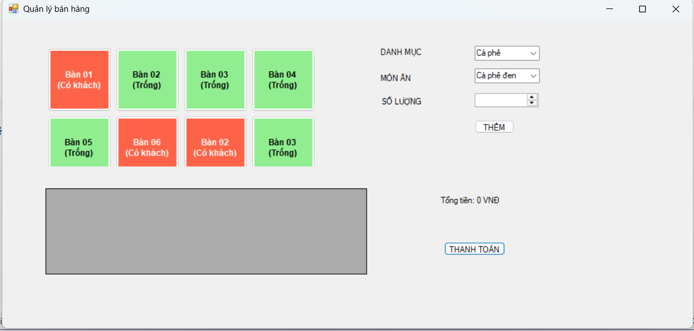
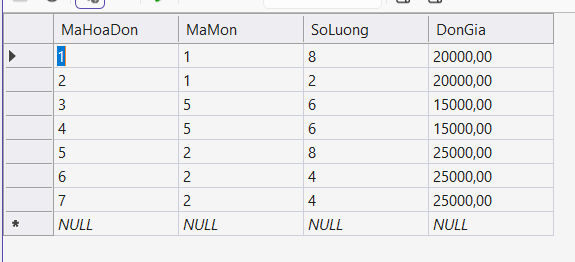
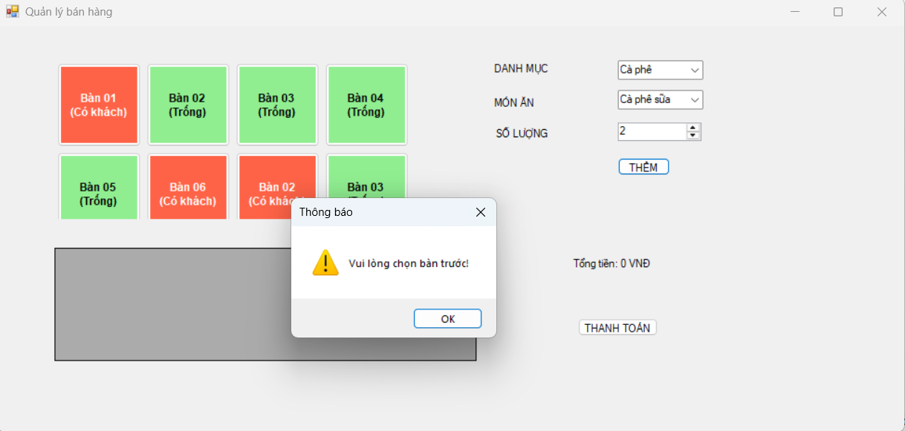
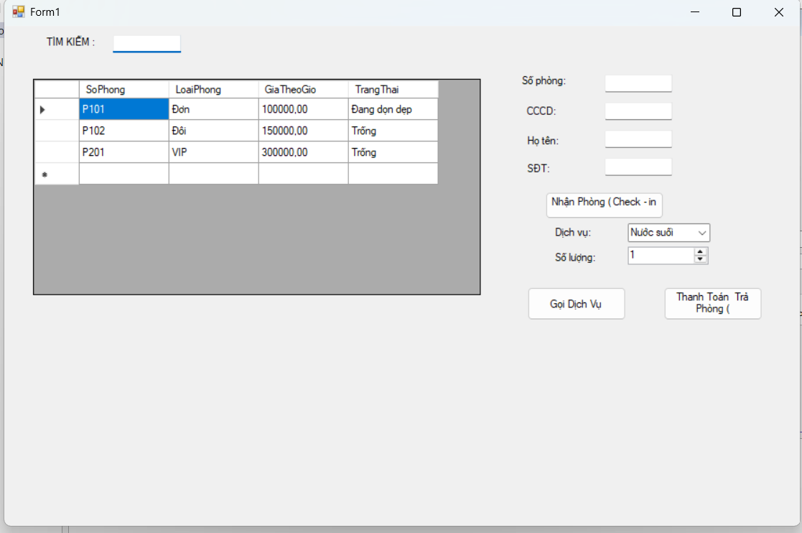
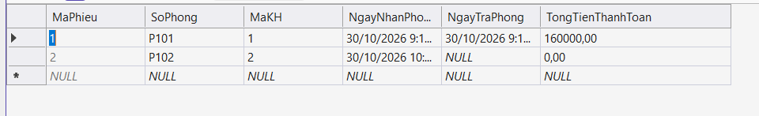
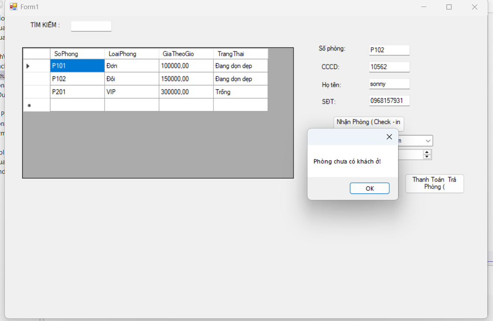
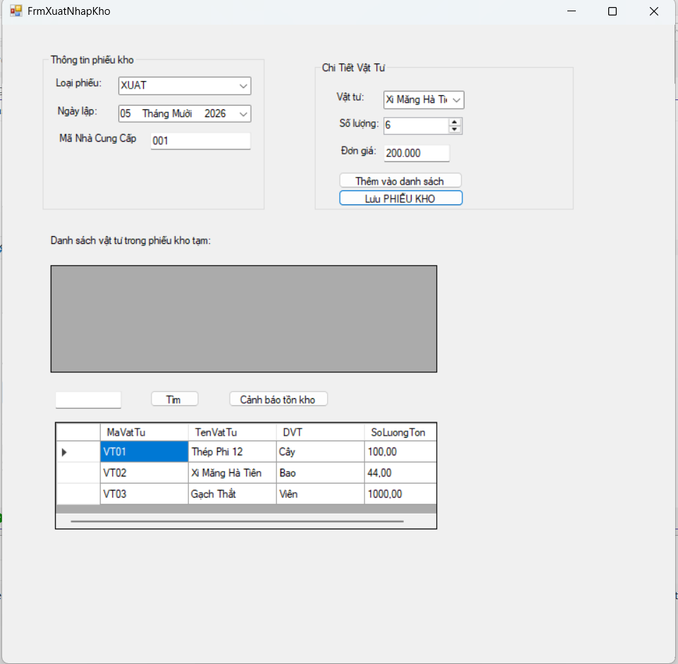
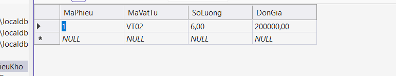

\# BÁO CÁO BÀI TẬP / ĐỒ ÁN MÔN HỌC

\## THÔNG TIN SINH VIÊN

\- \*\*Họ và tên:\*\* Nguyễn Trọng Hiếu

\- \*\*Mã số sinh viên:\*\* 24810320307

\- \*\*Lớp:\*\* D19QTANM1

\- \*\*Tên môn học:\*\* Lập trình C# / Windows Forms

\- \*\*Tên bài tập:\*\* BÀI TẬP NGÀY 30 THÁNG 10 (Bài 5.3, 5.4, 5.5)

\---

\## KẾT QUẢ THỰC HÀNH

\### BÀI 5.3: HỆ THỐNG QUẢN LÝ ĐẶT PHÒNG KHÁCH SẠN

\#### 1. Giao diện chính

\#### 2. Kết quả Thực thi / CSDL

\#### 3. Báo lỗi \& Validation

\---

\### BÀI 5.4: HỆ THỐNG BÁN HÀNG BẢN LẺ (POS)

\#### 1. Giao diện chính

\#### 2. Kết quả Thực thi / CSDL

\#### 3. Báo lỗi \& Validation

\---

\### BÀI 5.5: HỆ THỐNG QUẢN LÝ QUY TRÌNH XUẤT - NHẬP KHO

\#### 1. Giao diện chính

\#### 2. Kết quả Thực thi / CSDL

